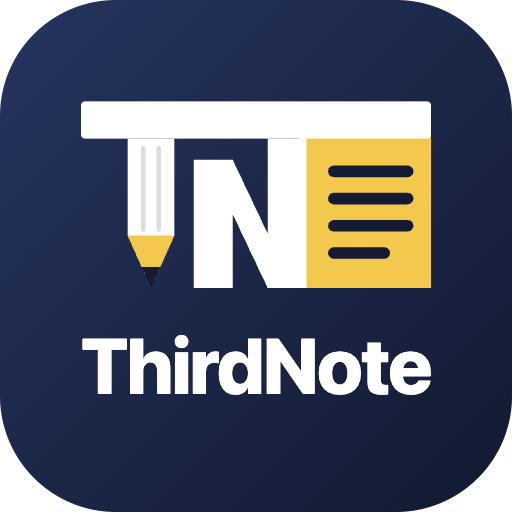
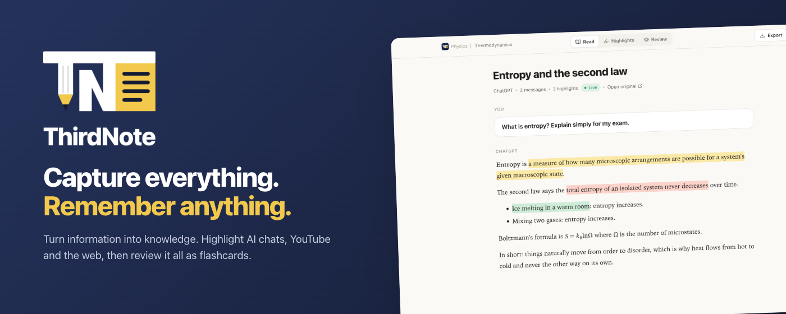

  

<h3 align="center">Capture everything. Remember anything.</h3>

  A Chrome extension that turns what you read in AI chats and on the web into notes you can review. 
  <a href="https://fahadmahmud2004.github.io/thirdnote/">Website</a> · <a href="https://fahadmahmud2004.github.io/thirdnote/privacy.html">Privacy</a>

---

## Features

- **Highlight anywhere.** Select text on any website, pick one of four colours (or press 1 to 4), and add a note if you like. Highlights come back when you revisit the page.
- **Save whole AI chats.** ChatGPT, Claude and Gemini are saved message by message; NotebookLM, DeepSeek, Perplexity, Grok, Copilot, Le Chat, Poe, Qwen, Kimi and Meta AI are saved as a whole conversation. New messages are added automatically while you keep chatting. Shared chat links can be imported.
- **Collections.** Group everything by subject, project or idea. Turn on *Collecting* and every save from any site goes straight into one collection.
- **Screenshots.** Capture any area of the screen with `Alt+Shift+S`. On YouTube the video timestamp is saved with a link back to that moment.
- **Notes.** Write your own notes into a collection from the side panel.
- **Review.** Read saved chats like clean notes, list only your highlights, or practise with flashcards where your own questions are the prompts.
- **Export** to Markdown or PDF.
- **Light and dark themes**, **English and Bangla**.
- **Private.** Everything is stored in your browser. No account, no servers, no tracking.

## Install for development

1. Open `chrome://extensions` and turn on **Developer mode**.
2. Click **Load unpacked** and choose this folder.
3. Reload any tabs that were already open.

## Project structure

| Path | Purpose |
|---|---|
| `manifest.json` | Extension manifest (Manifest V3) |
| `background.js` | Service worker: storage access, screenshots, context menu, shortcuts |
| `lib/` | Data layer (IndexedDB), text anchoring, HTML sanitising, translations, shared UI styles |
| `content/` | In-page toolbar, chat saving, screenshot capture, per-site chat adapters |
| `sidepanel/` | Library, collections and quick capture |
| `reader/` | Reading, highlights and flashcard review |
| `options/` | Settings |
| `docs/` | Website and privacy policy (GitHub Pages) |
| `store/` | Chrome Web Store images, brand assets and listing text |

## Author

Made by [Fahad Mahmud](https://fahadmahmud.com). Questions or feedback: fahadmahmud2004@gmail.com or [open an issue](https://github.com/fahadmahmud2004/thirdnote/issues).

© 2026 Fahad Mahmud. All rights reserved.
