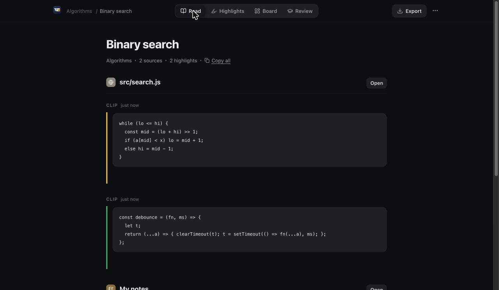
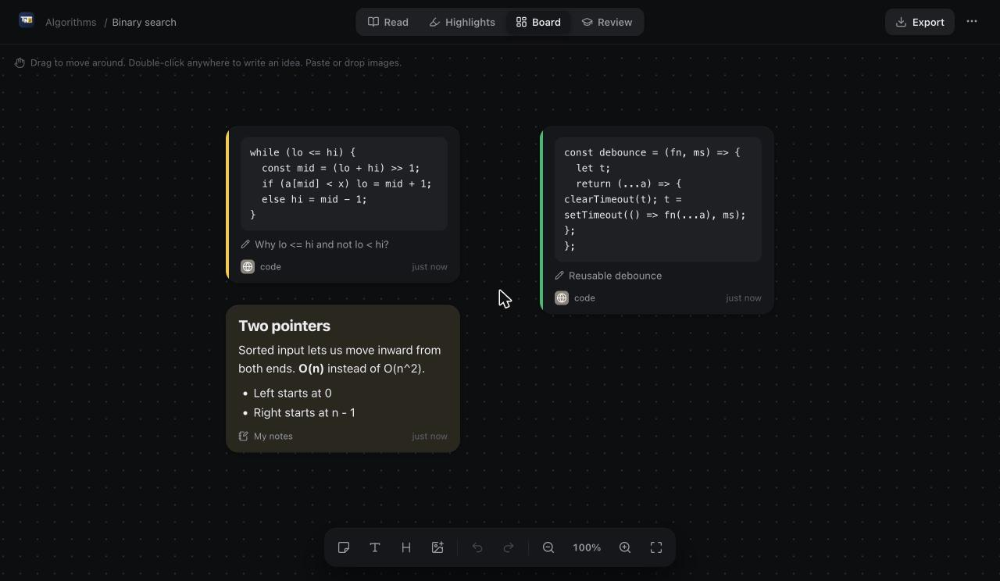

# ThirdNote for VS Code

**Capture code you want to remember, and actually remember it.**

The full ThirdNote experience inside VS Code: the same library, reader, rich editor, board and flashcard review as the [ThirdNote browser extension](https://fahadmahmud2004.github.io/thirdnote/), plus code highlights that stay on their code while you edit.

## Features

- **Highlight code in four colours.** Select code, right-click and choose **ThirdNote**, then a colour. Or press `Alt+Shift+H`, or `Alt+Shift+J` to add a note. Highlights show in the editor and on the scroll bar, and stay attached to their code while you add lines, type inside them or rename the file.
- **A real reader.** Every highlight, snippet and note opens in the ThirdNote reader. Edit anything like a document: headings, lists, bold, links, code blocks, and images (paste them or use the image button). Changes save as you type.
- **Board.** Lay out your code clips, notes, sticky notes and images on a free canvas for each collection, then zoom and arrange.
- **Review.** Your notes become the questions and your code becomes the answer, as flashcards.
- **Library.** All your collections in one place, with search, recent items and every highlight by colour.
- **Export.** One click to a real PDF file, or to Markdown. Back up and restore everything in Settings.
- **Collections.** Group by subject, project or idea. Turn on *Collecting* from the status bar and every new save goes straight into one collection.
- **Snippets, files and clipboard.** Save a selection as a snippet, keep a whole file, or press `Alt+Shift+V` to save whatever you copied from a chat, a doc or a terminal.
- **Hover for your note.** Hover a highlight to read its note, change its colour, open it in the reader or remove it.
- **Light and dark, English and Bangla.**
- **Private.** Everything is stored on your computer. No account, no servers, no tracking.

## Getting started

1. Select some code, right-click and choose **ThirdNote > Highlight Yellow** (or any colour).
2. Click the ThirdNote icon in the Activity Bar to see your collections, or press `Alt+Shift+K` to open the library.
3. Open a collection to read, write, arrange it on the board, review it or export it.

## Keyboard shortcuts

| Action | Shortcut |
|---|---|
| Highlight selection (pick a colour) | `Alt+Shift+H` |
| Highlight with a note | `Alt+Shift+J` |
| Write a note | `Alt+Shift+N` |
| Save clipboard | `Alt+Shift+V` |
| Open library | `Alt+Shift+K` |

Every command is also in the Command Palette under **ThirdNote**.

## Good to know

- **PDF:** ThirdNote makes the PDF with Chrome, Edge or Brave if one is installed. Without one, it opens the page in your browser, where you choose "Save as PDF".
- **Images:** paste them or use the image button. To drop an image file from your computer, hold Shift while dropping (a VS Code rule).
- **Your browser extension:** VS Code keeps its own notes. To bring notes across, use Settings > Export in one and Import in the other.

## Settings

| Setting | Default | What it does |
|---|---|---|
| `thirdnote.askForColor` | `true` | Ask for a colour when you press `Alt+Shift+H` |
| `thirdnote.defaultColor` | `yellow` | Colour used when you don't pick one |
| `thirdnote.showInEditor` | `true` | Show highlights in the editor and scroll bar |
| `thirdnote.showNoteAtLineEnd` | `true` | Show the start of a note at the end of its line |

## Feedback

Questions, ideas or bugs: [open an issue](https://github.com/fahadmahmud2004/thirdnote/issues) or write to fahadmahmud2004@gmail.com.

## About the developer

Made by **Fahad Mahmud** (BUET CSE, ex-NDC), founder of Freaking Waves.

- Portfolio: [fahadmahmud.com](https://fahadmahmud.com)
- Website: [freakingwaves.com](https://freakingwaves.com)
- Facebook: [facebook.com/fahadmahmud2004](https://www.facebook.com/fahadmahmud2004)
- Facebook Page: [facebook.com/freakingw](https://www.facebook.com/freakingw)
- Facebook Group: [facebook.com/groups/freakingwaves](https://www.facebook.com/groups/freakingwaves)
- Telegram Community: [t.me/freakingwaves](https://t.me/freakingwaves)
- GitHub: [github.com/fahadmahmud2004](https://github.com/fahadmahmud2004)

Other extensions by Fahad: [ThirdNote](https://marketplace.visualstudio.com/items?itemName=fahadmahmud2004.thirdnote) (code highlights, notes and flashcard review) and [Focus Waves](https://marketplace.visualstudio.com/items?itemName=fahadmahmud2004.focuswaves) (focus timer and live nature sounds).
