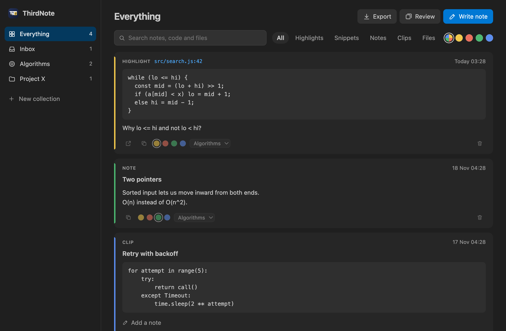
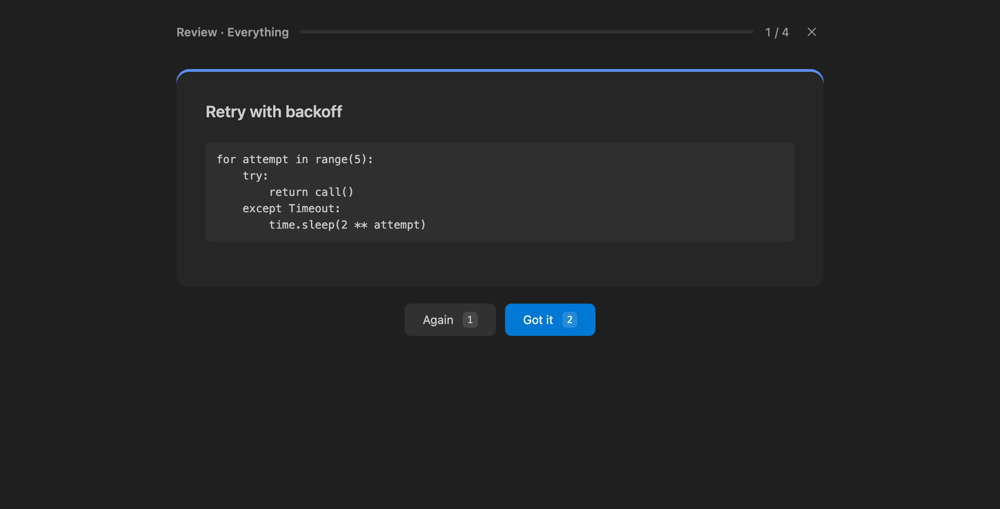

# ThirdNote for VS Code

**Capture code you want to remember, and actually remember it.**

ThirdNote turns the code you read into notes you can review. Highlight lines in any file with a colour and a note, save snippets and copied answers into collections, write your own notes next to your code, and review everything as flashcards. It is the VS Code companion to the [ThirdNote browser extension](https://fahadmahmud2004.github.io/thirdnote/).

## Features

- **Highlight code in four colours.** Select code and press `Alt+Shift+H`. Add a note with `Alt+Shift+J`. Highlights show in the editor and on the scroll bar, and your note appears faintly at the end of the line.
- **Highlights stay on the right code.** Add lines above, type inside, rename the file: ThirdNote keeps each highlight attached to its code. Reopen the file next week and it is still there.
- **Hover for your note.** Hover a highlight to read its note, change its colour, move it or remove it.
- **Collections.** Group everything by subject, project or idea. Turn on *Collecting* from the status bar and every new save goes straight into that collection. Drag items between collections in the sidebar.
- **Snippets, files and clips.** Save a selection as a titled snippet, keep a whole file, or press `Alt+Shift+V` to save whatever you copied from a chat, a doc or a terminal.
- **Write notes.** `Alt+Shift+N` opens a note composer in the library. Use the first line as a question to review it later.
- **Library.** Search everything, filter by type and colour, edit notes in place and jump back to the code with one click.
- **Review as flashcards.** Your notes become the questions and your code becomes the answer. Things you don't know yet come up first.
- **In This File.** A sidebar list of every highlight in the open file. Jump between them with *Go to Next Highlight*.
- **Export and back up.** Export a collection or everything to Markdown. Back up and restore everything as JSON.
- **Private.** Everything is stored on your machine. No account, no servers, no tracking.

## Keyboard shortcuts

| Action | Shortcut |
|---|---|
| Highlight selection | `Alt+Shift+H` |
| Highlight with a note | `Alt+Shift+J` |
| Write a note | `Alt+Shift+N` |
| Save clipboard | `Alt+Shift+V` |
| Open library | `Alt+Shift+K` |

Every command is also in the Command Palette under **ThirdNote**, and in the editor's right-click menu.

## Settings

| Setting | Default | What it does |
|---|---|---|
| `thirdnote.askForColor` | `true` | Ask for a colour each time you highlight |
| `thirdnote.defaultColor` | `yellow` | Colour used when you don't pick one |
| `thirdnote.showInEditor` | `true` | Show highlights in the editor and scroll bar |
| `thirdnote.showNoteAtLineEnd` | `true` | Show the start of a note at the end of its line |

You can change the highlight colours in your theme with `workbench.colorCustomizations`, for example `"thirdnote.yellow": "#F2C94C55"`.

## Where your data lives

ThirdNote keeps one file in VS Code's storage folder for the extension, so your highlights and notes follow you across every workspace on this computer. Nothing is sent anywhere. Use **ThirdNote: Back Up Everything (JSON)** to move them to another machine.

## Feedback

Questions, ideas or bugs: [open an issue](https://github.com/fahadmahmud2004/thirdnote/issues) or write to fahadmahmud2004@gmail.com.

Made by Fahad Mahmud (BUET CSE, ex-NDC).
